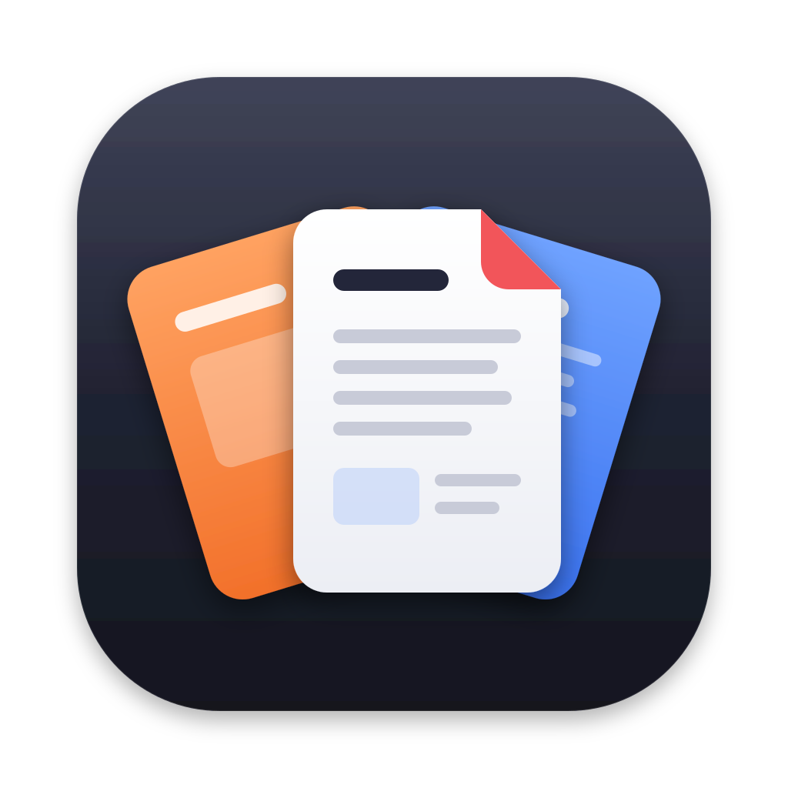

# Writan

A small, fast app for the documents most people actually open: **Word, PowerPoint, Excel, CSV, PDF, Markdown, plain text and images**, each in a tab of one window. Optional plugins add **LaTeX** and extra fonts.

Runs on macOS (Apple silicon), Windows (x64) and Debian/Ubuntu (x64). Everything runs locally: no accounts, nothing uploaded, works offline.

## Why

Word, PowerPoint and Preview are slow to open and heavy to keep running. Writan is built on [Tauri](https://tauri.app), so it uses the system's own web view instead of shipping a browser. It launches quickly, and each document engine loads only when you first open that kind of file.

## Install

Download the latest build from [Releases](https://github.com/elijahroizman/writan/releases/latest).

| | |
| --- | --- |
| **Mac** | Open `Writan_…_aarch64.dmg` and drag Writan to Applications. |
| **Windows** | Run `Writan_…_x64-setup.exe`. If Windows says it protected your PC, click **More info → Run anyway** (the app isn't code-signed for Windows yet). |
| **Debian, Ubuntu** | `sudo apt install ./Writan_…_amd64.deb` (Ubuntu 22.04 or Debian 12 and newer). |
| **Fedora** | `sudo dnf install ./Writan-…x86_64.rpm` |

The package name and the terminal command are `writan`. A machine that already has the `workspace` package picks up `writan` on its next system update. The command `workspace` remains and runs `writan`.

Writan keeps itself up to date. On Mac and Windows, new versions download in the background and install when you quit. On Linux, the .deb adds Writan's APT repository and the .rpm its dnf repository, so updates come with your system's other updates. See [Updating](docs/user/updating.md).

## Some notes

This is early software, mostly written by AI models, and it has bugs. LaTeX on Windows in particular is still being tested. Please [open an issue](https://github.com/elijahroizman/writan/issues) when something breaks.

## Documentation

- [What each editor can do](docs/user/features.md)
- [Keyboard shortcuts](docs/user/keyboard-shortcuts.md)
- [Plugins: images, LaTeX and fonts](docs/user/plugins.md)
- [Updating, and the APT repository](docs/user/updating.md)
- [What it doesn't do yet](docs/user/limitations.md)
- [Changelog](CHANGELOG.md)

Working on the code: [development](docs/internals/development.md), [releases and signing](docs/internals/releasing.md), [writing a plugin](plugins/README.md).

## Run it locally

You need [Node.js](https://nodejs.org) 20 or newer and [Rust](https://rustup.rs), plus your system's build tools:

- **Mac:** `xcode-select --install`
- **Windows:** [Microsoft C++ Build Tools](https://visualstudio.microsoft.com/visual-cpp-build-tools/) with "Desktop development with C++". WebView2 already comes with Windows 10 and 11.
- **Debian, Ubuntu:** `sudo apt install build-essential pkg-config libwebkit2gtk-4.1-dev libgtk-3-dev libayatana-appindicator3-dev librsvg2-dev libssl-dev libxdo-dev patchelf`

Then, from this folder:

```sh
rustup target add wasm32-unknown-unknown
cargo install wasm-bindgen-cli --version 0.2.129 --locked
npm install
npm run dev        # the UI in your browser at http://localhost:1420
npm run app:dev    # the real app, with hot reload
```

Both `npm run dev` and `npm run build` compile the document engine to WebAssembly. The wasm-bindgen CLI version must match `crates/office-wasm/Cargo.toml`.

The browser version uses file pickers and downloads in place of the native file dialogs, so it's enough for most UI work.

To build an installer for your own machine:

```sh
npm run app:build                   # Mac: .app and .dmg
npx tauri build --bundles nsis      # Windows: setup .exe
npx tauri build --bundles deb       # Debian, Ubuntu: .deb
```

The output lands in `src-tauri/target/release/bundle/`. A copy you build yourself isn't signed and doesn't update itself. On a Mac, open it the first time with right-click → **Open**.

Before opening a pull request, run `npm run typecheck`, `npm run build` and, if you changed Rust, `cargo check` in `src-tauri`. Read [CONTRIBUTING.md](CONTRIBUTING.md) first.

## Signing

Release builds are signed in GitHub Actions. Nothing secret lives in the repository.

- **Updates** are signed with a minisign key (`TAURI_SIGNING_PRIVATE_KEY`). Installed copies check it against the public key in `src-tauri/tauri.conf.json`. Plugin downloads are checked against the same key.
- **The Mac app** is signed with a Developer ID certificate and notarized by Apple.
- **The APT and dnf repositories** are signed with a GPG key (`APT_SIGNING_KEY`). The .deb and .rpm install the public half.
- **Windows** builds aren't code-signed yet.

[Releases and signing](docs/internals/releasing.md) lists every secret and what breaks if one is lost.

## Thanks

Word, PowerPoint and Excel files run on Writan's own engine, written in Rust ([crates](crates)). Writan is also built on open-source engines and fonts: [PDFium](https://pdfium.googlesource.com/pdfium/) through [EmbedPDF](https://github.com/embedpdf/embed-pdf-viewer), [CodeMirror](https://codemirror.net), [markdown-it](https://github.com/markdown-it/markdown-it), the Carlito, Caladea and Liberation fonts, and many more. **Settings › General › Open-source licenses** lists every one with its license. The theme picker is heavily inspired by [T3 Code](https://github.com/pingdotgg/t3code)'s.
